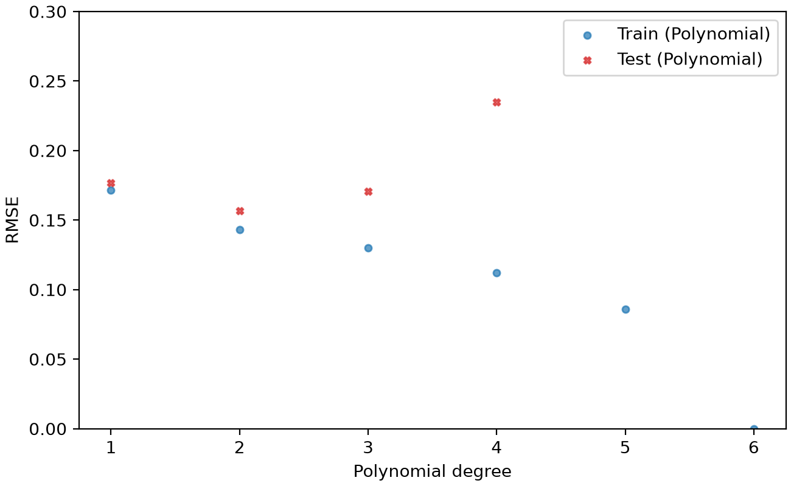
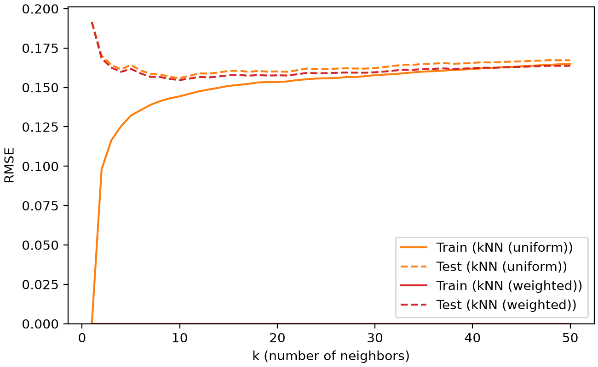
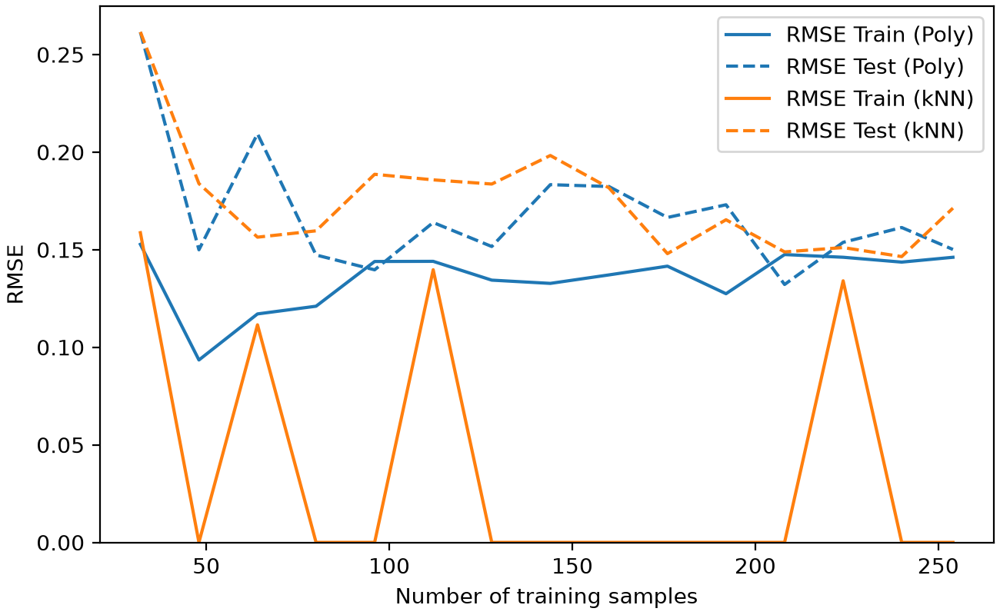
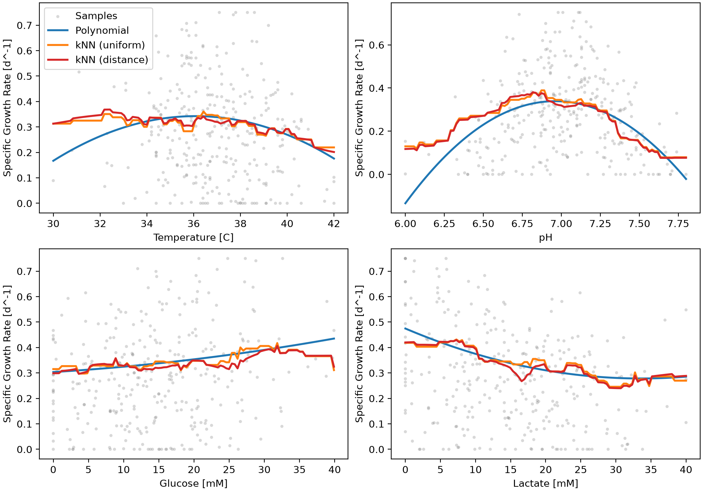

# Predicting Cell Growth Rates Using Machine Learning
The purpose of this file is the prediction of cell growth through the application of machine learning packages in Python. Whole cell bioprocesses are dependent on many dynamic parameters that impact growth rates. By applying machine learning, growth rates can be more reliably predicted based on known process parameters than is possible by simple calculation.

## Highlights

- Built scikit-learn pipelines for polynomial and kNN regression
- Tuned model hyperparameters using grid search cross-validation
- Compared uniform and distance-weighted kNN against polynomial regression
- Designed reusable classes for models, batches, and learning curves
- Evaluated model performance using training, validation, and test RMSE

## Environment

- Python 3.14.7
- numpy 2.5.2
- pandas 3.0.5
- scikit-learn 1.9.0
- matplotlib 3.11.0

## Code Design

The program is run from `main.py`, which calls on three `.py` files in the `src` folder. `constants.py` stores
fixed settings such as the dataset path, the train-test split ratio, and the hyperparameter values to search.
`functions.py` contains general functions such as using df to call pandas to read the dataset. `classes.py` contains the classes that hold the machine
learning models and batch data. Keeping the bulk of the code in separate files means `main.py` is more streamlined and increases the ease of editing. 

### Data Loading

The program first reads the cell growth dataset from a CSV file using pandas. The specific growth rate is taken as the
target, and temperature, pH, glucose concentration, and lactate concentration are taken as the features. A summary of
the dataset (mean, standard deviation, minimum, and maximum of each column) is printed to the terminal. This stage is
necessary because every later step depends on the data being loaded with the correct target and features, and the
summary gives a quick check that the ranges of each variable are reasonable.

### Preprocessing

The program processes that data from the csv before any model training begins. The data is split up in to targets and
features, and then converted to numpy arrays. The primary preprocessing step is the standardization of data to ensure 
that all data is weighted equally when performing analysis. 

### Train-Test Split

The data is split so that 80 % is used for training and 20 % is held out as a test set. A fixed random state (0) is used
so that the same split is produced every time the program runs. The test set is never used to train the
models. It is only used at the end to measure how well each model predicts data that ir was not trained on. Without this
separation, the reported error would reflect how well a model memorizes the training data rather than how well it
predicts the behaviour of new cultures

### Model Setup

Each model is created as a `GrowthRateModel` object, which stores a name, a scikit-learn pipeline, and a grid of
hyperparameters to search. Three models are built, all beginning with the `StandardScaler` to standardize the data:

- A polynomial regression pipeline: `PolynomialFeatures` &rarr; `LinearRegression`
- A kNN regression pipeline with uniform weights using `KNeighborsRegressor`
- A kNN regression pipeline with distance weights using `KNeighborsRegressor`

Pipelines combine preprocessing and the regression model into one object, so the same standardization learned from
the training data is automatically applied to any new data. Standardization is needed because the features are on
very different scales. Glucose and lactate range from 0 to 40 mM while pH ranges from about 6 to 8. kNN relies on
distances between samples, so without scaling, the features with the largest numbers would unfairly impact the test 
data prediction.

### Hyperparameter Optimization

Each model runs a grid search with 5-fold cross-validation on the training set. For the polynomial model, degrees 1
through 6 are tested. For each kNN model, values of k from 1 to 50 are tested. The training data is divided into
five folds. Each combination of hyperparameters is trained on four folds and validated on the fifth, rotating until
every fold has been used for validation. The combination with the lowest average validation RMSE is selected and
refit to the full training set. This stage exists because hyperparameters such as the polynomial degree and the
number of neighbors cannot be learned from the data directly. Choosing them by cross-validation balances minimizes 
overfitting/underfitting.

### Model Results

Once tuned, the program prints the key details of each model. For the polynomial model, it prints the selected
degree, the intercept, and the coefficient of every term.
The size and magnitude of each coefficient indicates how strongly and in what way that term affects the
growth rate. For the two kNN models, it prints the selected number of neighbors and the weighting method. The
program then prints the training, validation, and test RMSE of all three models side by side. Comparing these values
shows which model predicts most accurately and whether any model is overfitting, which shows up as a much lower
training error than validation or test error.

### Learning Curve

The `LearningCurve` class repeats the model tuning on random subsets of the data of increasing size, from 40 samples
up to the full dataset. For each subset, new polynomial and kNN models are tuned and their training and test RMSE are
recorded. This stage shows whether the models would benefit from more data. If the test error keeps falling as samples
are added, collecting more data would likely improve overall predictions.

### Batch Predictions

Finally, the `Batch` class represents an individual cell culture defined by its pH and temperature setpoints, along
with its glucose and lactate concentrations. Several example batches are created, and the polynomial model predicts
the specific growth rate of each one. Each batch also reports whether its pH and temperature fall within the typical
optimal operating range. This class is an example of how the model can be applied practically; the growth rate can be 
predicted based on known values, and then the prediciton can be compared with other sources to determine desired 
parameters for a given process. 

### Figure and Plot Generation

Finally, the program outputs 4 plots and 4 tables, the designs of which are defined in `functions.py`. The plots show 
the polynomial validation curve, the knn validation curve, the learning curve, and response curves. Tables
are generated to display the dataset summary, the coefficients generated from the polynomial, the rmse for each method, 
and predicted growth rates based on theoretical batches with different parameters. 

## Analysis

### Model Selection
The model selected for was a polynomial regression of degree 2. It was built as a pipeline that used `StandardScaler` 
&rarr; `PolynomialFeatures` &rarr; `LinearRegression`. Degree 2 was chosen because it resulted in the lowest validation 
RMSE (about 0.157) in the 5-fold grid search over the range of degree 1 - 6. Degree 1 resulted in underfitting, while 
degrees 3 and above resulted in overfitting, as seen in figure 1. 

_Figure 1_: Polynomial validation curve. Shown in red is the RMSE for the test data at a given degree. Blue is the training data RMSE at degrees 1 - 6. As seen with the higher degree models, the training data RMSE decreases gradually, while the test data RMSE increases exponentially, indicating severe overfitting. 

At degrees 5 and 6, the RMSE significantly exceeded 
that for lower degrees, and cannot be seen on the plot. The quadratic relation likely suits the data as it allows for a 
peak at a given ideal parameter, with drop-off on either side of the maximum. 

### Comparison with kNN

k was searched from 1 to 50 using both the uniform and weighted methods, and performed best at k = 10 (Seen in figure 2).

_Figure 2_: kNN validation curves. Training and test RMSE is compared for both uniform and weighted models. At ~10, the RMSE's become similar, and become relatively constant at higher k values. Red indicates the weighted model, while orange indicates the uniform model. 

The models utilizing a small k resulted in overfitting, with an RMSE of 0 for the training data, and high error on the test data,
while higher orders resulted in underfitting, as too many data points were considered for a given point. All three models - 
uniform kNN, weighted kNN, and polynomial resulted in similar overall RMSE's, ranging from 0.156 to 0.158. With regards
to the response curves, kNN's are jagged and abrupt, while polynomial's are relatively smooth, which is expected behaviour 
for the two models (Shown in figure 4). Overall, the polynomial was selected because it resulted in a smooth, and more importantly, 
simpler model to predict growth rates.

### Advantages and Limitations

The main advantage of the polynomial model is that it can be written as a single equation, where each coefficient can 
be interpreted directly. Since the features were standardized before fitting, the size of each coefficient can be 
compared to the others to see which parameters have the largest impact on growth rate. The model also produces smooth 
response curves and makes predictions quickly, as it does not need to store the training data like kNN does. As seen in 
table 1, the training, validation, and test RMSE are all close to one another, indicating that the model is not 
overfitting.

_Table 1_: Training, validation, and test RMSE for the three models.

| Model          | RMSE Train [d^-1] | RMSE Valid [d^-1] | RMSE Test [d^-1] |
|----------------|-------------------|-------------------|------------------|
| Polynomial     | 0.1444            | 0.1568            | 0.157            |
| kNN (uniform)  | 0.1423            | 0.1559            | 0.1584           |
| kNN (weighted) | 0.0               | 0.1547            | 0.1557           |

The weighted kNN model resulted in a training RMSE of 0, regardless of k. This is because each training point is its 
own nearest neighbour, with a distance of 0, so it is weighted far above any other point. As a result, the training 
RMSE of the weighted model does not indicate how well it fits the data, and only the validation and test RMSE can be 
used to compare it to the other models.

The main limitation of the model is the size of its error. A test RMSE of about 0.157 d^-1 is large when compared to 
the mean growth rate of about 0.28 d^-1, so the model is better suited to predicting trends than exact values. The 
dataset also contains samples with a growth rate of exactly 0, which were not removed, and are difficult for a smooth 
model to fit. Another limitation is that the polynomial predicts negative growth rates at extreme pH values, which is 
not physically possible (Shown in figure 4).

_Figure 3_: Learning curve. Solid lines show the training RMSE and dashed lines show the test RMSE for the polynomial 
(blue) and kNN (orange) models. The kNN training RMSE drops to 0 whenever the weighted model is employed.

As seen in figure 3, the test RMSE of both models drops quickly from about 40 to about 100 training samples, and then 
levels off at around 0.15. The training and test RMSE of the polynomial converge at the larger sample sizes, which 
suggests that collecting more of the same data would not significantly improve predictions. The remaining error is 
more likely due to noise in the data, or other factors that were not measured. It should be noted that the learning 
curve is noisy, as only one random subset was used at each sample size.

### Impact of Process Parameters on Growth Rate

The effect of each parameter can be seen through the coefficients of the polynomial (Table 2) and the response curves 
(Figure 4). Since the features were standardized, a larger coefficient means a larger effect on the growth rate, and 
the sign shows whether it increases or decreases the growth rate.

_Table 2_: Polynomial coefficients for the standardized features.

| Term                    | Coefficient |
|-------------------------|-------------|
| Intercept               | 0.3383      |
| [Temperature]           | -0.0186     |
| [pH]                    | -0.0131     |
| [Glucose]               | 0.0254      |
| [Lactate]               | -0.0600     |
| [Temperature]^2         | -0.0205     |
| [Temperature]*[pH]      | -0.0204     |
| [Temperature]*[Glucose] | -0.0093     |
| [Temperature]*[Lactate] | -0.0117     |
| [pH]^2                  | -0.0610     |
| [pH]*[Glucose]          | -0.0023     |
| [pH]*[Lactate]          | 0.0026      |
| [Glucose]^2             | 0.0030      |
| [Glucose]*[Lactate]     | -0.0210     |
| [Lactate]^2             | 0.0150      |

_Figure 4_: Response curves for each parameter. One parameter is varied across its range while the others are held at 
their mean values. Gray points are the samples from the dataset, blue is the polynomial, orange is the uniform kNN, and 
red is the weighted kNN.

pH had the strongest effect on growth rate, with the largest coefficient of all terms ([pH]^2 = -0.061). The negative 
squared term results in a clear peak in growth rate at a pH of about 6.9 - 7.0, with a sharp drop-off on either side. 
Lactate had the second-largest effect, with a linear coefficient of -0.060, and growth rate decreased steadily as 
lactate increased from 0 to about 30 mM. This is expected, as lactate is a byproduct of cell metabolism that inhibits 
growth at high concentrations. Glucose had a smaller positive effect (+0.025), as more substrate is available for the 
cells to grow. Temperature had the weakest effect, with a slight peak at about 36 &deg;C. Most of the interaction terms 
were small, with the exception of temperature x pH and glucose x lactate, which were both about -0.02. 

It should be noted that the samples in figure 4 are widely scattered around all of the curves. This shows that no 
single parameter can explain the growth rate on its own, which is consistent with the large RMSE of the model.

### Culture Conditions

To show how the model responds to different culture conditions, the growth rate was predicted for four theoretical 
batches (Table 3). The optimal pH and temperature were taken as the average of the optimal operating range (pH 6.8 - 
7.2 and 35 - 37 &deg;C).

_Table 3_: Predicted growth rates for four theoretical batches using the polynomial model.

| Batch ID | pH  | Temperature [C] | Glucose [mM] | Lactate [mM] | In Optimal Range | Predicted Growth Rate [d^-1] |
|----------|-----|-----------------|--------------|--------------|------------------|------------------------------|
| 1        | 7.0 | 36.0            | 15.0         | 15.0         | True             | 0.3422                       |
| 2        | 7.0 | 36.0            | 30.0         | 3.0          | True             | 0.5444                       |
| 3        | 7.0 | 36.0            | 3.0          | 30.0         | True             | 0.3053                       |
| 4        | 6.4 | 40.0            | 15.0         | 15.0         | False            | 0.1597                       |

The highest growth rate was predicted for batch 2 (0.54 d^-1), which had an optimal pH and temperature, high glucose, 
and low lactate. Batch 1 represents a typical culture at the average glucose and lactate concentrations, and resulted 
in a growth rate of 0.34 d^-1. Reversing the glucose and lactate concentrations in batch 3 reduced the growth rate to 
0.31 d^-1, and moving the pH and temperature outside of the optimal range in batch 4 reduced it further to 0.16 d^-1. 
Overall, high growth rates are expected at a pH of about 7.0, a temperature of about 36 &deg;C, high glucose, and low 
lactate, while low growth rates are expected at high lactate or when pH and temperature are far from their optimums.

Predictions may be unreliable for a pH below about 6.1 or above about 7.7, where the polynomial predicts negative 
growth rates. Predictions near the edges of the temperature range (30 &deg;C and 42 &deg;C) are also less reliable, 
as there are fewer samples in these regions. The model should not be used for conditions outside of the range of the 
dataset (Table 4), or for combinations of conditions that rarely appear in the data, as the polynomial is not 
reliable when extrapolating.

_Table 4_: Summary of the dataset.

| Variable                    | Mean    | Standard Deviation | Minimum | Maximum |
|-----------------------------|---------|--------------------|---------|---------|
| Specific Growth Rate [d^-1] | 0.2834  | 0.1885             | 0.0     | 0.75    |
| Temperature [C]             | 36.9167 | 2.0269             | 30.0    | 42.0    |
| pH                          | 6.9982  | 0.3379             | 6.0     | 7.8     |
| Glucose [mM]                | 14.6642 | 8.7503             | 0.0     | 39.9    |
| Lactate [mM]                | 14.8016 | 9.2628             | 0.0     | 40.0    |

### Potential Applications

The model could be used to screen potential culture conditions before running real batches, as shown with the `Batch` 
class. Rather than running an experiment for every combination of pH, temperature, and feed concentration, the model 
can be used to narrow down which conditions are most likely to result in a high growth rate, and only those 
conditions would then need to be tested. The results also support a feeding strategy that keeps glucose high while 
limiting the build-up of lactate, along with tight pH control near 7.0. 

Due to the size of its error, the model should be used as a tool to guide experiments rather than replace them. 
Future improvements could include setting negative predictions to 0, investigating the samples with a growth rate of 0, 
averaging the learning curve over several random subsets, and measuring additional process parameters that may 
explain the remaining error.